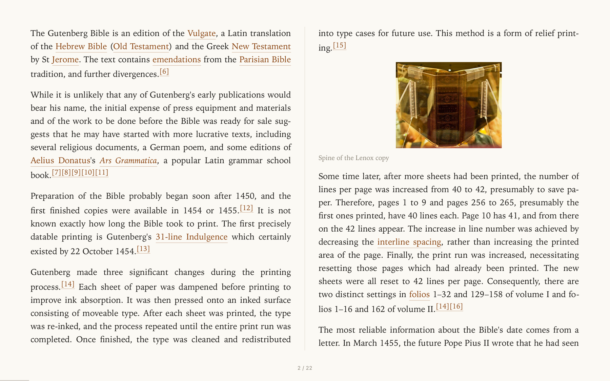

# TwoUp

Read any web article full screen on a Mac as a two-page spread, like an open book.



TwoUp pulls the article text out of a page (with Mozilla's [Readability](https://github.com/mozilla/readability)), sets it in two columns, and turns pages a spread at a time. It can also read your [Readwise Reader](https://readwise.io/read) queue.

## Install

Requires macOS 13 or later and the Xcode command line tools (`xcode-select --install`).

```bash
git clone https://github.com/willtmc/two-up-reader.git
cd two-up-reader
./build.sh
```

`build.sh` compiles the app and installs it to `~/Applications/TwoUp.app`.

## Use

- **Read the tab you're on:** with an article open in Safari, Chrome, Arc, Brave, or Edge, launch TwoUp. It reads the front tab and goes full screen. ⌘B does the same later.
- **Read a URL:** ⌘L and paste it, or ⌘V a URL anywhere in the app. From a terminal: `open -a TwoUp --args https://example.com/article`.
- **Read your Reader queue:** paste a token from [readwise.io/access_token](https://readwise.io/access_token) on the start screen. Inbox, Later, and Shortlist appear there.

On the last spread of a Reader article, **Mark as read** saves 100% reading progress, moves the article to Archive, and returns to your queue. **Back to queue** returns directly to the list. For a pasted URL or browser tab, use **Choose another article**.

| Key | Action |
|---|---|
| → ↓ space, click right half, swipe | Next spread |
| ← ↑ ⇧space, click left half | Previous spread |
| Home / End | First / last spread |
| + / − | Text size |
| T | Theme: paper, sepia, dark |
| F | Serif or sans |
| O | Open the original page in your browser |
| A | Archive in Readwise Reader and return to the queue. On the last spread, also mark as read. |
| ? | Show keys |
| Esc | Leave full screen |

### Logged-in and paywalled pages

When TwoUp reads your browser tab, it asks the browser for the page as you see it, so pages you're logged in to come through. That needs one browser setting:

- **Chrome, Arc, Brave, Edge:** View → Developer → Allow JavaScript from Apple Events
- **Safari:** Develop → Allow JavaScript from Apple Events

Without it, TwoUp loads the URL on its own, without your login. The first tab read also asks you to let TwoUp control the browser (System Settings → Privacy & Security → Automation).

## Privacy

No accounts, analytics, or servers of its own. Pages load directly from their sites. Your Readwise token is stored in the macOS Keychain and sent only to readwise.io.

## Credits

- [Readability](https://github.com/mozilla/readability) by Mozilla, Apache License 2.0, vendored in `Resources/Readability.js`.
- The screenshot shows the Wikipedia article [Gutenberg Bible](https://en.wikipedia.org/wiki/Gutenberg_Bible) (CC BY-SA 4.0).

## License

MIT. See [LICENSE](LICENSE).
